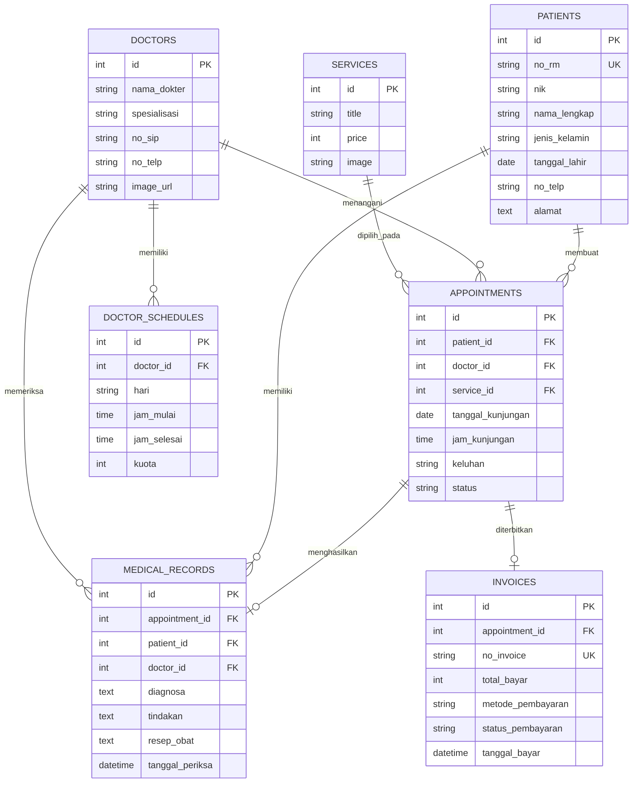

# API Design & ERD — Final Project (Sehatin)

Dokumentasi rancangan API dan Entity Relationship Diagram (ERD) untuk aplikasi klinik Sehatin.

## Menjalankan aplikasi

Jalankan backend dan frontend dari terminal terpisah:

```bash
cd backend && npm run dev
cd frontend && npm run dev
```

Backend menggunakan Supabase Database dan auth aplikasi dari `backend/.env`.
Auth tidak memakai Supabase Auth. Tambahkan `SUPABASE_SERVICE_ROLE_KEY` hanya di
backend untuk operasi tabel `users`, serta `JWT_SECRET` untuk menandatangani token.
Jangan masukkan service role key ke frontend atau repository.
Sebelum memakai fitur dokter, jadwal, dan pasien, jalankan DDL dari
`backend/src/schema.js` di Supabase SQL Editor. URL API frontend dapat diubah
dengan environment variable `VITE_API_URL`.

Foto layanan diunggah langsung dari dashboard admin ke Supabase Storage.
Backend akan membuat bucket public bernama `services` secara otomatis saat
upload pertama menggunakan `SUPABASE_SERVICE_ROLE_KEY`.
Foto profil dokter juga diunggah langsung dari dashboard dokter. Backend akan
membuat bucket public `doctors` secara otomatis saat upload pertama.

Halaman `/login` menyediakan masuk sebagai Guest, serta masuk dan registrasi
akun Pasien atau Admin. Login Dokter tidak tersedia; data dokter dan jadwal
tetap dikelola oleh Admin. API layanan, daftar dokter, dan jadwal dapat dibaca
tanpa login.

Schema membuat tabel public `users` sebagai akun aplikasi. Password disimpan
sebagai hash dan token login dibuat oleh backend. Role yang didukung adalah
`patient`, `doctor`, dan `admin`; ubah role pengguna melalui dashboard admin
atau secara manual di Supabase SQL Editor:

Jika tabel `users` sudah dibuat sebelum auth aplikasi ditambahkan, jalankan
migrasi ini satu kali di Supabase SQL Editor:

```sql
ALTER TABLE public.users
DROP CONSTRAINT IF EXISTS users_id_fkey;

ALTER TABLE public.users
ADD COLUMN IF NOT EXISTS password_hash TEXT;

ALTER TABLE public.users
DROP CONSTRAINT IF EXISTS users_role_check;

ALTER TABLE public.users
ADD CONSTRAINT users_role_check
CHECK (role IN ('patient', 'doctor', 'admin'));

ALTER TABLE public.patients
ADD COLUMN IF NOT EXISTS user_id UUID UNIQUE REFERENCES public.users(id) ON DELETE CASCADE;

ALTER TABLE public.doctors
ADD COLUMN IF NOT EXISTS user_id UUID UNIQUE REFERENCES public.users(id) ON DELETE CASCADE;

ALTER TABLE public.services
ADD COLUMN IF NOT EXISTS category VARCHAR(50) NOT NULL DEFAULT 'lainnya';

CREATE TABLE IF NOT EXISTS public.appointments (
  id BIGINT GENERATED BY DEFAULT AS IDENTITY PRIMARY KEY,
  patient_id BIGINT NOT NULL REFERENCES public.patients(id) ON DELETE CASCADE,
  doctor_id BIGINT NOT NULL REFERENCES public.doctors(id) ON DELETE CASCADE,
  service_id BIGINT REFERENCES public.services(id) ON DELETE SET NULL,
  tanggal_kunjungan DATE NOT NULL,
  jam_kunjungan TIME NOT NULL,
  keluhan TEXT,
  status VARCHAR(50) DEFAULT 'pending',
  created_at TIMESTAMPTZ DEFAULT NOW()
);
```

Registrasi akun baru otomatis membuat user ber-role `patient` dan profil awal
di tabel `patients`. Admin dapat mengubah role patient menjadi doctor dari
dashboard. Setelah login ulang, dokter mengisi profilnya sendiri dan backend
menyimpannya ke tabel `doctors`.

```sql
CREATE TABLE IF NOT EXISTS public.users (
  id UUID PRIMARY KEY DEFAULT gen_random_uuid(),
  email VARCHAR(255) UNIQUE NOT NULL,
  nama_lengkap VARCHAR(255) NOT NULL,
  password_hash TEXT,
  role VARCHAR(20) NOT NULL DEFAULT 'patient'
    CHECK (role IN ('patient', 'admin')),
  created_at TIMESTAMPTZ DEFAULT NOW(),
  updated_at TIMESTAMPTZ DEFAULT NOW()
);

UPDATE public.users SET role = 'admin'
WHERE email = 'admin@contoh.com';
```

Jalankan bagian `CREATE TABLE` terlebih dahulu. Jika tabel belum ada, query
`UPDATE public.users` akan menghasilkan error `42P01 relation does not exist`.
Perubahan data layanan/dokter/jadwal dan seluruh akses data pasien hanya untuk
Admin. Data dokter tetap merupakan data klinik dan bukan akun login.

Endpoint terlindungi memvalidasi JWT buatan backend. Akun baru langsung dapat
login setelah berhasil disimpan di tabel `users`; tidak ada email confirmation
atau rate limit dari Supabase Auth.

---

## 1. API Design

### Fitur Layanan Medis (Services)
| HTTP Method | Endpoint | Deskripsi |
| :--- | :--- | :--- |
| `GET` | `/services` | Mengambil semua daftar layanan klinik |
| `GET` | `/api/services/:id` | Mengambil detail layanan berdasarkan ID |
| `POST` | `/api/services` | Menambahkan data layanan baru |
| `PUT` | `/api/services/:id` | Mengupdate data layanan klinik |
| `DELETE` | `/api/services/:id` | Menghapus layanan klinik |

### Fitur Dokter & Jadwal (Doctors & Schedules)
| HTTP Method | Endpoint | Deskripsi |
| :--- | :--- | :--- |
| `GET` | `/api/doctors` | Mengambil daftar seluruh dokter |
| `GET` | `/api/doctors/:id` | Mengambil detail profil dokter |
| `GET` | `/api/doctors/:id/schedules` | Mengambil jadwal praktek dokter |
| `POST` | `/api/doctors` | Menambahkan data dokter baru |
| `PUT` | `/api/doctors/:id` | Mengupdate profil dokter |
| `POST` | `/api/doctors/:id/schedules` | Menambahkan jadwal praktek dokter |
| `DELETE` | `/api/doctors/:id` | Menghapus data dokter |

### Fitur Pasien (Patients)
| HTTP Method | Endpoint | Deskripsi |
| :--- | :--- | :--- |
| `GET` | `/api/patients` | Mengambil data seluruh pasien |
| `GET` | `/api/patients/:id` | Mengambil detail pasien dan riwayatnya |
| `POST` | `/api/patients` | Mendaftarkan data pasien baru |
| `PUT` | `/api/patients/:id` | Mengupdate data identitas pasien |
| `DELETE` | `/api/patients/:id` | Menghapus data pasien |

### Fitur Reservasi / Janji Temu (Appointments)
| HTTP Method | Endpoint | Deskripsi |
| :--- | :--- | :--- |
| `GET` | `/api/appointments` | Mengambil daftar janji temu |
| `GET` | `/api/appointments/:id` | Mengambil detail janji temu |
| `POST` | `/api/appointments` | Membuat booking janji temu baru |
| `PATCH` | `/api/appointments/:id/status` | Mengupdate status janji temu (pending, confirmed, completed, cancelled) |
| `DELETE` | `/api/appointments/:id` | Membatalkan janji temu |

### Fitur Rekam Medis (Medical Records)
| HTTP Method | Endpoint | Deskripsi |
| :--- | :--- | :--- |
| `GET` | `/api/medical-records` | Mengambil daftar rekam medis |
| `GET` | `/api/medical-records/:id` | Mengambil detail hasil pemeriksaan dan resep |
| `GET` | `/api/patients/:id/medical-records` | Mengambil riwayat rekam medis pasien tertentu |
| `POST` | `/api/medical-records` | Menambahkan catatan pemeriksaan dokter |
| `PUT` | `/api/medical-records/:id` | Mengupdate catatan rekam medis |

### Fitur Pembayaran / Invoice (Billing)
| HTTP Method | Endpoint | Deskripsi |
| :--- | :--- | :--- |
| `GET` | `/api/invoices` | Mengambil daftar invoice/tagihan |
| `GET` | `/api/invoices/:id` | Mengambil detail tagihan pembayaran |
| `POST` | `/api/invoices` | Membuat tagihan pembayaran baru |
| `PATCH` | `/api/invoices/:id/payment` | Mengupdate status pembayaran (paid, unpaid) |

---

## 2. Entity Relationship Diagram (ERD)



### Tabel yang Diperlukan:
1. **patients**: Data identitas pasien (`id`, `no_rm`, `nik`, `nama_lengkap`, `jenis_kelamin`, `tanggal_lahir`, `no_telp`, `alamat`).
2. **doctors**: Data tenaga medis/dokter (`id`, `nama_dokter`, `spesialisasi`, `no_sip`, `no_telp`, `image_url`).
3. **services**: Data layanan klinik (`id`, `title`, `price`, `image`). Selaras dengan data pada endpoint `/services`.
4. **doctor_schedules**: Jadwal praktek dokter (`id`, `doctor_id`, `hari`, `jam_mulai`, `jam_selesai`, `kuota`).
5. **appointments**: Reservasi janji temu pasien (`id`, `patient_id`, `doctor_id`, `service_id`, `tanggal_kunjungan`, `jam_kunjungan`, `keluhan`, `status`).
6. **medical_records**: Rekam medis hasil diagnosa dan resep dokter (`id`, `appointment_id`, `patient_id`, `doctor_id`, `diagnosa`, `tindakan`, `resep_obat`, `tanggal_periksa`).
7. **invoices**: Data tagihan dan status pembayaran (`id`, `appointment_id`, `no_invoice`, `total_bayar`, `metode_pembayaran`, `status_pembayaran`, `tanggal_bayar`).
